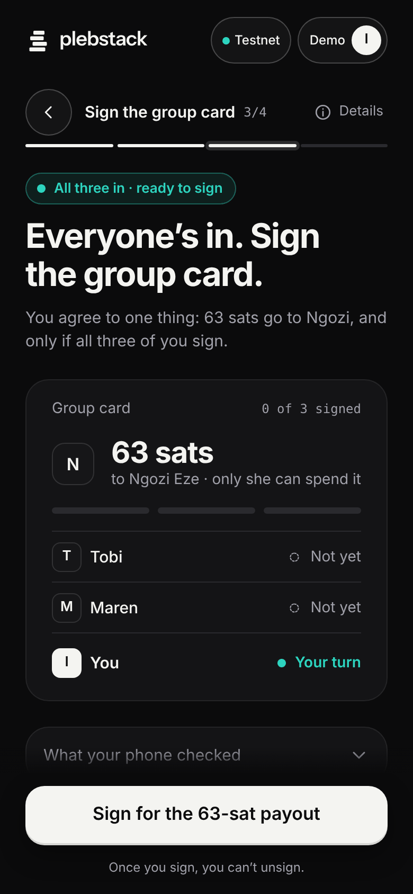

# Plebstack

Three plebs, 21 sats each, one maintainer paid all at once or not at all.

Plebstack is a small crowdfunding app on Cashu ecash. I wanted to back the people who keep my tools running without trusting anyone in the middle to hold the money. So: each backer locks their own deposit to their own key at a mint. When all three have signed, one batch pays the maintainer 63 sats, locked to her key. If the stack never fills, everyone takes their own sats back. The organizer never holds a key or a sat.

It runs against the test mint `https://testnut.cashudevkit.org`, which pays its own invoices. The sats are fake; the protocol calls are real.


## How it works

In plain words:

1. **Ada starts a stack.** She names who it's for (Ngozi, a maintainer), what the work is, and a close time. Ngozi opens a claim link and confirms her key on her own device. Only the public half goes on the board.
2. **Three plebs join and pay.** Each one pays a real invoice for 21 sats at the mint. The deposit is locked to that pleb's key, so nobody else can mint it.
3. **Everyone checks and signs.** Each pleb sees the same payout: 63 sats to Ngozi's key. The last signature sends it.
4. **Ngozi is paid.** The mint issues the 63 sats locked to Ngozi's key. She spends them with her key and keeps 62 after the mint's 1-sat fee, as ecash she can paste into any Cashu wallet.
5. **If it doesn't fill by the close time,** collecting stops and each pleb takes their own 21 back.

In NUT terms:

- **NUT-20** locked mint quotes: each deposit is a quote signed by the backer's key, so only they can mint it.
- **NUT-29** batch mint: the three quotes are minted together in one request carrying all three signatures. All or nothing.
- **NUT-11** P2PK: the batch's outputs are locked to Ngozi's public key.
- **NUT-03** swap: Ngozi unlocks and swaps the payout (the 1-sat fee is the keyset's `input_fee_ppk`).
- **NUT-09** restore and **NUT-07** state checks bring things back after a reload and settle races.

`src/protocol/README.md` goes through every call, what it guarantees, and what is real. The rules I held to: save before sending anything to the mint, only call it Paid once the mint has confirmed and the proofs are saved, and never retry a pending request with new outputs.

## Run it

Node 22.12 or later.

```sh
npm i
npm run dev
```

Open the address Vite prints (usually `http://localhost:5173`) in a phone-sized window. Tap **Start a stack** and you're Ada. "Playing as" at the top of each screen switches between Ada, Ngozi and the three plebs (Tobi, Maren, Ishaan), so one browser can play the whole thing. `?live=1` from older links still works; the app always talks to testnut now.

### The stage

Open `/stage` in a second window (or **Open the stage in a new window** under Playing as). It's a 16:9 view for a meetup screen or a demo: the shared stack on the goal line, each pleb's phone, Ngozi's phone, and a caption that says what just happened at the mint. It follows the other window by itself, no clicks. A slab only travels into the stack when the mint confirms the deposit. On a tall screen it stacks into a portrait layout. With Reduce Motion on, nothing moves and the captions carry it.

## Tests

```sh
npm test                         # unit tests: states, close rule, roles, copy, contrast
npm run build                    # type check and production build
PLEB_LIVE=1 npm run test:live    # deposit, payout and reclaim against testnut
node scripts/live-e2e.mjs        # every journey in headless Chromium, with accessibility checks
node scripts/stage-demo.mjs      # drives the stage; --shots retakes stills, --video records it
```

The browser runs use Playwright and axe, and check names, contrast, focus, 320px reflow and a keyboard-only walk. They write their output to `.evidence/`.

## Honest limits

- **Test mint only.** testnut pays its own invoices. Nothing here has been near real sats.
- **One browser plays everyone.** Each person has their own namespace in local storage, and no one's code reads another's key, but they all live in one browser.
- **No relay.** A shared "public board" in local storage stands in for one (Nostr would be the obvious fit). Open the stage in the same browser.
- **No key backup.** Clear your storage and the keys are gone, along with any sats locked to them.
- **A signature can't be taken back,** and a take-back can race the payout. The app shows whichever one the mint accepted.
- **Paid means Ngozi received ecash,** not that the work got done.

## Screenshots

Phone stills from a live run are in [`docs/screens-live/`](docs/screens-live/).

| Join | Sign | Paid | Spent |
| --- | --- | --- | --- |
|  |  |  |  |

## Where things are

- `src/protocol/` — the mint calls, keys, per-person storage, batch signing and recovery.
- `src/live/` — one client per person, the public board, and the view rebuilt from it.
- `src/domain/` — the money states and the close rule.
- `src/screens/`, `src/ui/`, `src/styles/` — the phone app and the stage. Plain CSS, night only.

## License

MIT. See [LICENSE](LICENSE).
