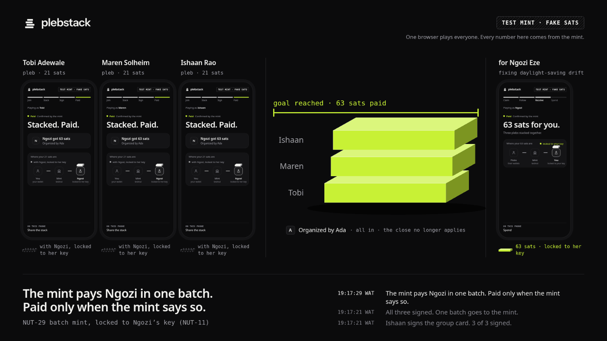
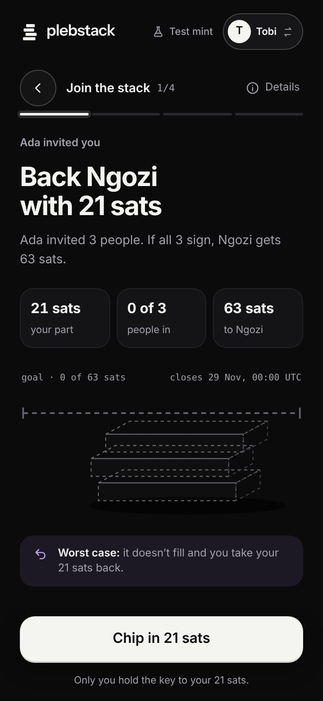
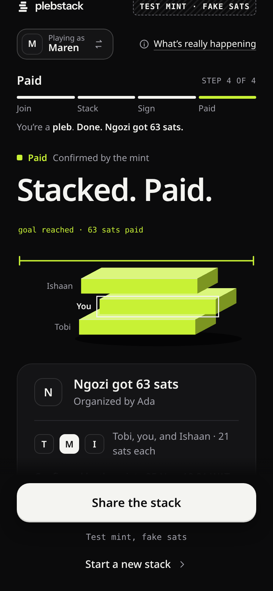
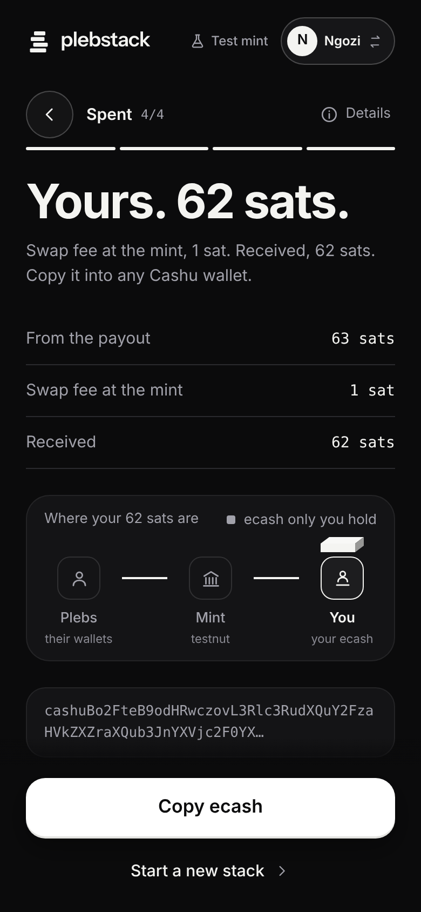

# Plebstack

Three plebs, 21 sats each, one maintainer paid all at once or not at all.

Plebstack is a small crowdfunding app on Cashu ecash. I wanted to back the people who keep my tools running without trusting anyone in the middle to hold the money. So: each backer locks their own deposit to their own key at a mint. When all three have signed, one batch pays the maintainer 63 sats, locked to her key. If the stack never fills, everyone takes their own sats back. The organizer never holds a key or a sat.

**Try it:** https://plebstack-matts-projects-7a791133.vercel.app. Start a stack on one phone and share the invite link: each person joins from their own phone. Open `/stage` on a big screen to watch it fill.

It runs against the test mint `https://testnut.cashudevkit.org`, which pays its own invoices. The sats are fake; the protocol calls are real.



## How it works

In plain words:

1. **Ada starts a stack.** She names who it's for (Ngozi, a maintainer), what the work is, and a close time. Ngozi opens a claim link and confirms her key on her own device. Only the public half goes on the board.
2. **Three plebs join and pay.** Each one pays a real invoice for 21 sats at the mint. The deposit is locked to that pleb's key, so nobody else can mint it.
3. **Everyone checks and signs.** Each pleb sees the same payout: 63 sats to Ngozi's key. The last signature sends it.
4. **Ngozi is paid.** The mint issues the 63 sats locked to Ngozi's key. She spends them with her key and keeps 62 after the mint's 1-sat fee, as ecash she can paste into any Cashu wallet.
5. **If it doesn't fill by the close time,** collecting stops and each pleb takes their own 21 back.

In NUT terms:

- **NUT-20** locked mint quotes: each deposit is a quote signed by the backer's key, so only they can mint it.
- **NUT-29** batch mint: the three quotes are minted together in one request carrying all three signatures. All or nothing.
- **NUT-11** P2PK: the batch's outputs are locked to Ngozi's public key.
- **NUT-03** swap: Ngozi unlocks and swaps the payout (the 1-sat fee is the keyset's `input_fee_ppk`).
- **NUT-09** restore and **NUT-07** state checks bring things back after a reload and settle races.

`src/protocol/README.md` goes through every call, what it guarantees, and what is real. The rules I held to: save before sending anything to the mint, only call it Paid once the mint has confirmed and the proofs are saved, and never retry a pending request with new outputs.

## Run it

Node 22.12 or later.

```sh
npm i
npm run dev
```

Open the address Vite prints (usually `http://localhost:5173`). A first visit shows three short intro screens; after that the app opens on home: your stack, and **Start a stack**, **Join a stack** and **Watch live**.

### Several devices

Each person uses their own device, and their keys never leave it. Ada starts a stack and shares two links: a claim link for Ngozi, who confirms her key on her own phone, and an invite link for the plebs. Whoever opens the invite takes the next free pleb seat.

The devices share one public board over Nostr. Every write (the stack's terms, each locked quote, each signature, the payout result) is published as an event tagged with the stack's id, and each device merges what it hears. Only public material goes out; keys stay where they were made. The relays default to `relay.damus.io`, `nos.lol` and `relay.primal.net`. Set others with `?relays=wss://a,wss://b` (remembered on that device) or `VITE_RELAYS` at build time. `npm run relay` starts a small local relay for trying it on your own network.

### Demo mode

For a demo on one device, tap your initial at the top right: you can switch to any person, start a new stack as Ada, reset the demo, or open the stage. Each person still keeps their own part of the browser's storage, and nobody's screen reads anyone else's key.

### The stage

Tap **Watch live** on home, or open `/s/<stack id>/stage` on any screen. It's a 16:9 view for a meetup screen or a demo: the shared stack on the goal line, each pleb's phone, Ngozi's phone, and a caption that says what just happened at the mint. It follows the stack by itself over the relays, no clicks. A slab only travels into the stack when the mint confirms the deposit. On a tall screen it stacks into a portrait layout. With Reduce Motion on, nothing moves and the captions carry it.

## Tests

```sh
npm test                         # unit tests: states, close rule, roles, copy, contrast
npm run build                    # type check and production build
PLEB_LIVE=1 npm run test:live    # deposit, payout and reclaim against testnut
node scripts/live-e2e.mjs        # every journey in headless Chromium, with accessibility checks
npm run test:devices             # five devices, one stack, over a local Nostr relay, against testnut
node scripts/stage-demo.mjs      # drives the stage; --shots retakes stills, --video records it
```

The browser runs use Playwright and axe, and check names, contrast, focus, 320px reflow, a keyboard-only walk and the desktop layout. They write their output to `.evidence/`. The device run checks that each phone takes its own seat, the payout reaches Ngozi's phone, and no private key ever reaches the relay.

## Honest limits

- **Test mint only.** testnut pays its own invoices. Nothing here has been near real sats.
- **Seats, not accounts.** The cast is fixed for now: Ada organizes, Ngozi is paid, and the three plebs are Tobi, Maren and Ishaan, whichever device gets there first.
- **Public relays.** The board travels over public Nostr relays. Anyone can read it, which is fine because it only ever holds public material, but a relay can drop events. A device that misses one hears it again on reload.
- **No key backup.** Clear your storage and the keys are gone, along with any sats locked to them.
- **A signature can't be taken back,** and a take-back can race the payout. The app shows whichever one the mint accepted.
- **Paid means Ngozi received ecash,** not that the work got done.

## Screenshots

Phone stills from a live run are in [`docs/screens-live/`](docs/screens-live/), with the desktop layout in `desktop-1440.png`.

| Join | Sign | Paid | Spent |
| --- | --- | --- | --- |
|  |  |  |  |

## Where things are

- `src/protocol/` — the mint calls, keys, per-person storage, batch signing and recovery.
- `src/live/` — one client per person, the public board, its Nostr sync (`sync.ts`), and the view rebuilt from it.
- `src/domain/` — the money states and the close rule.
- `src/screens/`, `src/ui/`, `src/styles/` — the app and the stage. Plain CSS, night only.
- `scripts/relay.mjs` — a small local Nostr relay; `scripts/multi-device.mjs` drives five devices through it.

## License

MIT. See [LICENSE](LICENSE).
