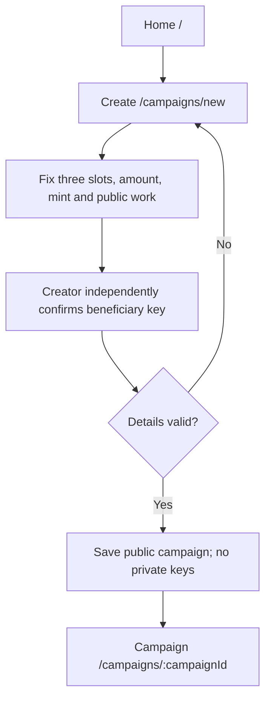
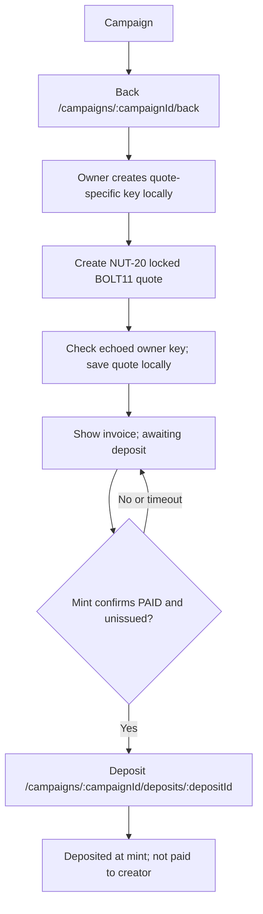
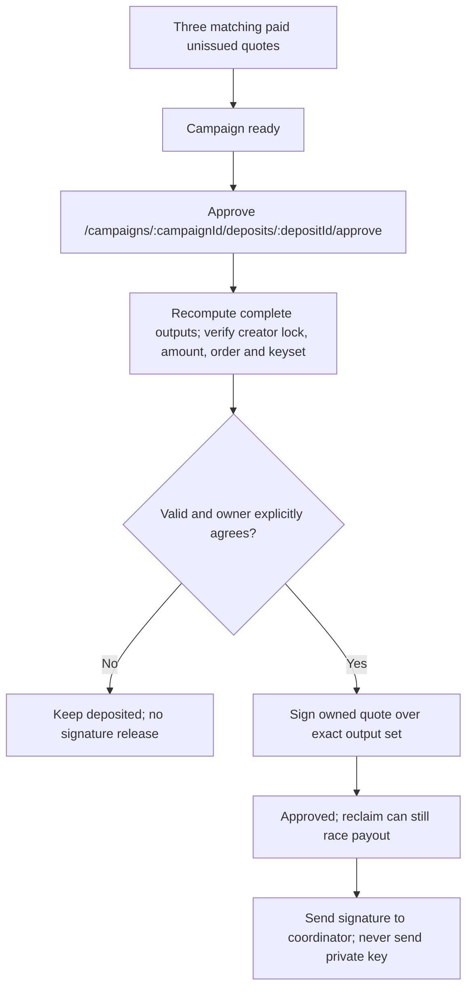
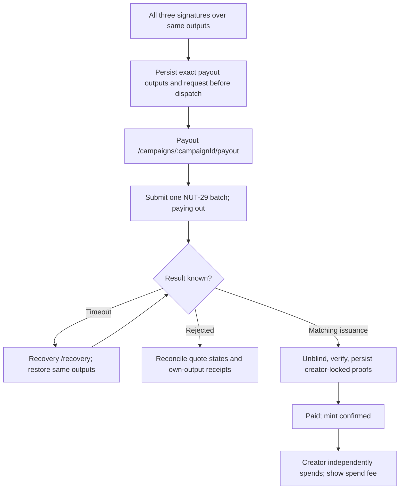
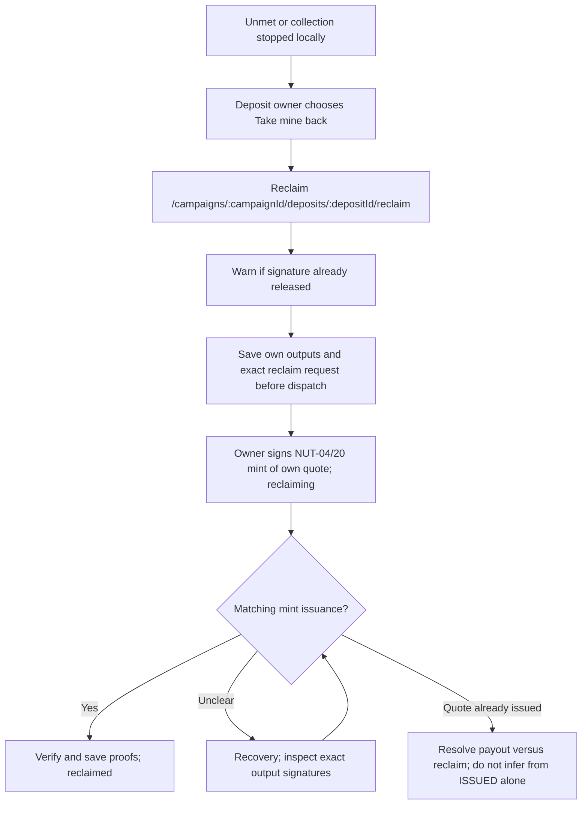
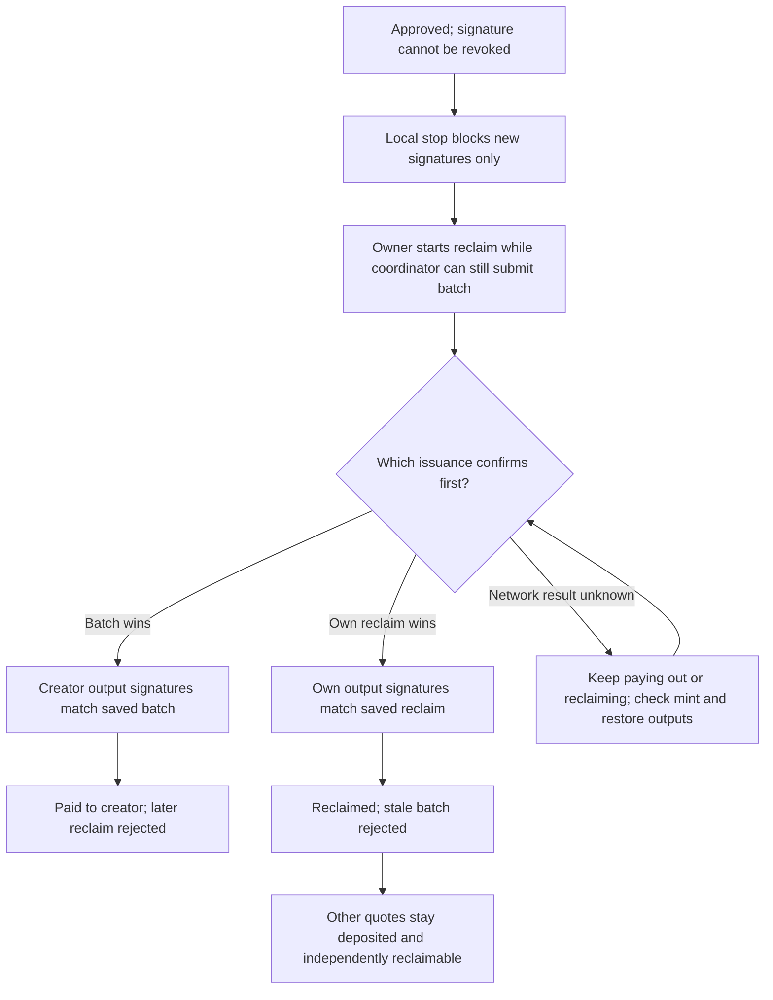

# Information architecture and flows

Stable paths below are implemented by the prototype. Parameters are identifiers, not secrets. History fallback to `index.html` will be needed on any later host; this task does not deploy a host.

| Route | Purpose |
| --- | --- |
| `/` | Explain the control boundary and link to creation / illustrative campaign |
| `/campaigns/new` | Fix public-work details, beneficiary and three equal deposits |
| `/campaigns/:campaignId` | Campaign facts, deposited total and group readiness |
| `/campaigns/:campaignId/back` | Create owner-locked BOLT11 quote and fund deposit |
| `/campaigns/:campaignId/deposits/:depositId` | Owner's deposit status and direct recovery entry |
| `/campaigns/:campaignId/deposits/:depositId/approve` | Verify outputs and explicitly release signature |
| `/campaigns/:campaignId/deposits/:depositId/reclaim` | Owner reclaim, warning, confirmation and race outcome |
| `/campaigns/:campaignId/payout` | Complete batch status and creator receipt |
| `/recovery` | Resume locally persisted operations and inspect unresolved results |
| unmatched path | Page not found with home link |

Sitemap: home → create campaign → campaign → back → deposit → approve or reclaim. Campaign → payout. Global navigation → recovery. All money pages must show mint identity, ownership and current sentence. The prototype uses stub campaigns and a stub mint, and performs no real operations. Adding `?demo=1` to any path opens the recording bar; `?beat=<id>` loads one step of the demo script (`src/demo/beats.ts`).

## Create campaign

## Back

## Approve

## Payout

## Unmet and reclaim

## Released-signature race

The spike tested both orderings sequentially, not simultaneous contention. There is no “cancelled means safe” terminal money state. A countdown or local deadline cannot expire a released signature.
